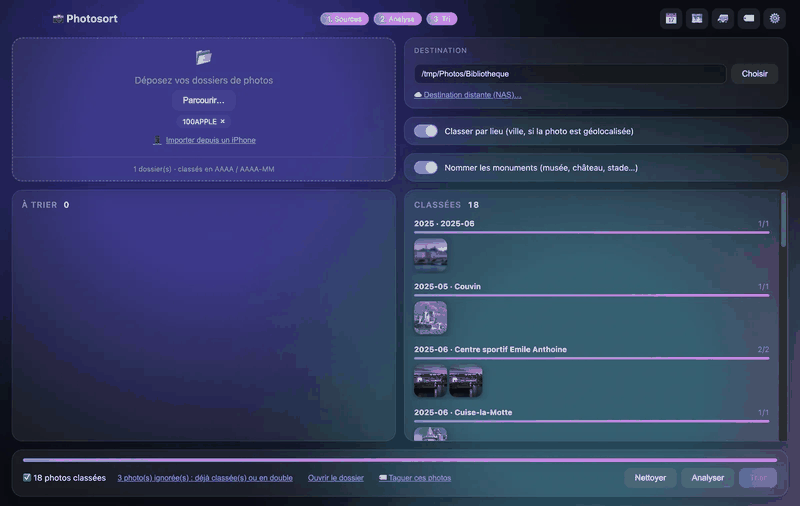
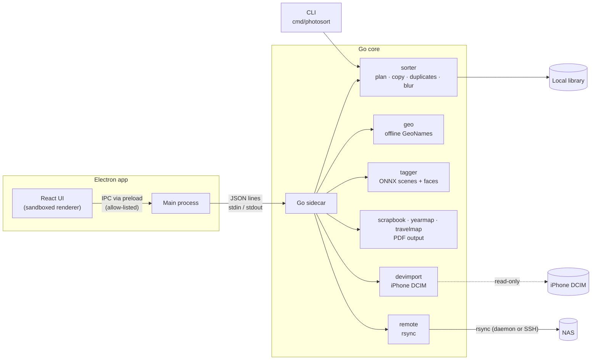

# Photosort

**Sort your photos by date and place — on your disk or straight onto your NAS. No cloud, no account, and your originals are never touched.**

[](https://github.com/OWNER/REPO/actions/workflows/ci.yml) <!-- TODO: replace OWNER/REPO once the repository URL is known -->
[](LICENSE)
[](#status)



<sub>Demo screenshots use public-domain (CC0) photos — see the [credits](website/src/assets/screenshots/CREDITS.md). They are placeholders and will be replaced by real captures.</sub>

## What it does

Drop in your photo folders (or plug in an iPhone) and Photosort copies every picture into a clean library:

```text
2026/2026-10/Rouen/2026-10-20 - iPhone - 1.heic
```

- **Sorts by date and place** — year / month folders from the EXIF capture date, plus an optional city or landmark folder resolved **offline** from GPS coordinates.
- **Tidies up** — skips exact duplicates, groups near-duplicates and blurry shots, sets screenshots aside, and falls back to the filename or file date when EXIF is missing.
- **Imports from an iPhone** — reads the mounted DCIM folder: everything, only new photos, or a date range; pauses and resumes if the cable is unplugged.
- **Sorts straight to a NAS** — sends the result with rsync (daemon or SSH), for example to a QNAP, and never deletes anything there.
- **Travel and scrapbook** — printable weekly photo sheets, a "photos of the year" map and trip route maps, as PDFs.
- **Optional AI tags** — local scene and face detection (ONNX) written to `.xmp` files next to the copies.
- **Private by design** — everything runs locally. Originals are only read, files are never overwritten, and the only network uses are opt-in map tiles and a one-time download of the AI models.

The interface is available in **French, English and Danish**.

## Download

Installers (macOS `.dmg`, Windows portable `.exe`, Linux `.AppImage` and `.deb`) are built by the release workflow and attached to the project's **GitHub Releases**; release candidates are marked as pre-releases. They are **not code-signed yet** — see [Status](#status).

## How it works

1. **Plan** — Photosort scans your sources and builds a plan without writing anything: EXIF reading, plus optional hashing for duplicates, blur and similarity detection. You can review the proposed tree first.
2. **Copy** — it copies the photos into the destination (locally, or through rsync to a NAS), never overwriting an existing file and removing partial copies on error or cancel.

One Go engine powers the command-line tool, a small Fyne desktop app and the full Electron app.

## Tech stack

| Layer | Technology |
| --- | --- |
| Engine, CLI, sidecar | **Go** — EXIF via [imagemeta](https://github.com/evanoberholster/imagemeta), HEIC/AVIF decoding through WASM, embedded GeoNames data |
| Desktop app | **Electron + React + TypeScript** (Vite), sandboxed renderer, allow-listed IPC |
| AI tags | **ONNX Runtime** with Places365 (scenes) and YuNet (faces) models |
| Remote sort | **rsync** over daemon or SSH |
| Website | **Astro** (static, French / English / Danish) |
| CI / release | GitHub Actions, electron-builder |

## Architecture



## Technical highlights

- **Originals are sacred**: copy-only, no overwrite, and source and destination must be disjoint (even through symlinks).
- **Streamed plans**: large plans travel in bounded chunks over the sidecar protocol, and CI runs performance guards on this path.
- **Offline geocoding**: embedded GeoNames data resolves cities and landmarks without any coordinate leaving the machine.
- **Fast image reading**: a forked JPEG decoder reads images at 1/8 scale to feed duplicate and AI detection quickly.
- **Safe iPhone import**: files go through a private transit directory in ~200 MB batches; a per-device journal records a photo only after verified delivery.
- **Hardened IPC**: every request field is allow-listed and size-capped in the main process; NAS passwords are never written to logs or settings.
- **Supply chain checks**: GitHub Actions pinned by commit SHA, `govulncheck`, `actionlint` and an npm audit gate in CI.

More detail: [architecture map](docs/CONTEXT_MAP.md) · [sorting rules](docs/sorting-rules.md) · [CLI and Fyne app](docs/cli.md) · [remote sort to a NAS](docs/remote-sort.md) · [QNAP setup](docs/nas-qnap.md).

## Status

Photosort is a **1.0 release candidate** (`1.0.0-rc.1`). Please keep in mind:

- It has been validated with a real iPhone and a QNAP NAS from a **Linux machine (AppImage)**. **Windows and macOS are less tested.**
- **macOS builds are not signed or notarized**, so macOS asks for confirmation on first launch.
- **ONNX Runtime is not available for Intel Macs**, so AI tags are disabled there.
- Videos, Live Photos and `.AAE` / `.XMP` companion files are not handled.

Found something unexpected? Please open an issue.

## Contributing

Contributions are welcome — see [CONTRIBUTING](docs/CONTRIBUTING.md) and the [Code of Conduct](docs/CODE_OF_CONDUCT.md).

## License

[MIT](LICENSE). Offline place data comes from [GeoNames](https://www.geonames.org) (CC BY 4.0).
